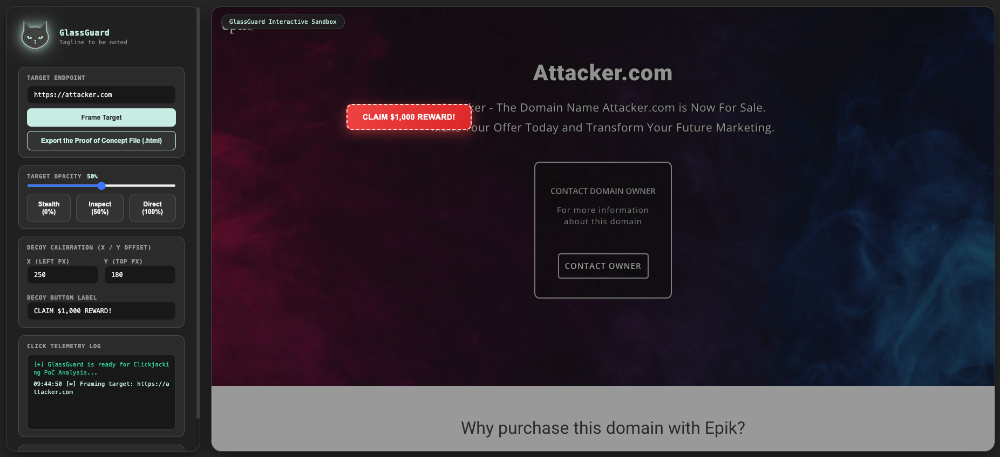

<div align="center">

  

  <h1>GlassGuard</h1>

  <p align="center">
    
  </p>

  <p align="center">
    
    
    
    
    <a href="./LICENSE">
      
    </a>
  </p>

  <p>See the Frame. Test the Click.</p>

</div>


## Overview

GlassGuard is a browser-based workspace for authorized clickjacking and user-interface redress assessments.

It lets an assessor load a target endpoint in an iframe, adjust frame visibility, position a visible decoy element, observe click-coordinate telemetry, and export a standalone HTML proof-of-concept file for controlled validation and reporting.

> GlassGuard is intended for authorized web-application security testing, security awareness demonstrations, and defensive-control validation. Do not use it to induce unintended actions from real users or against systems outside your authorized scope.

## Features

| Capability | What it does |
| :--- | :--- |
| Target framing | Loads a supplied HTTP or HTTPS endpoint into an embedded iframe. |
| Frame-opacity control | Adjusts target-frame visibility from fully hidden to fully visible. |
| Inspection presets | Provides Stealth, Inspect, and Direct visibility modes. |
| Decoy calibration | Positions a decoy element using configurable horizontal and vertical pixel offsets. |
| Decoy customization | Changes the decoy button label from the control panel. |
| Click telemetry | Records the X and Y coordinates of clicks within the interactive sandbox. |
| Timestamped log | Displays assessment events and click telemetry in a scrolling log. |
| PoC export | Creates a downloadable standalone HTML proof-of-concept file based on the current configuration. |

## Screenshots:

### Interface


## Assessment Workflow

1. Open GlassGuard in a modern desktop browser.
2. Enter an authorized target endpoint.
3. Select **Frame Target** to load the endpoint into the sandbox iframe.
4. Adjust frame opacity to inspect alignment or demonstrate visibility behavior.
5. Calibrate the decoy element position and label.
6. Interact with the sandbox and review click-coordinate telemetry.
7. Export a standalone HTML proof-of-concept file when needed for authorized documentation or validation.

## Visibility Modes

| Mode | Frame opacity | Intended use |
| :--- | :--- | :--- |
| Stealth | 0% | Tests a fully transparent framing scenario |
| Inspect | 50% | Helps align the decoy element with the framed interface |
| Direct | 100% | Provides full visual verification of the framed target |

The opacity slider supports continuous adjustment from 0% to 100%.

## Technology

| Component | Purpose |
| :--- | :--- |
| HTML | Application structure and standalone PoC export |
| CSS | CursedSec-style interface, layout, panels, and controls |
| JavaScript | Framing, opacity control, decoy calibration, telemetry, and export logic |
| iframe | Embedded target-endpoint rendering |
| Blob / URL.createObjectURL | In-browser generation and download of the HTML PoC file |

## Installation

GlassGuard is a self-contained HTML application. No build step, server, package installation, or external JavaScript dependency is required.

1. Save the application as `GlassGuard.html`.
2. Open it in a modern desktop browser.
3. Enter an authorized target URL.
4. Select **Frame Target**.

For controlled testing, serve the file from a local web server if your browser or target application restricts local-file iframe behavior.

```bash
python3 -m http.server 8080
```

Then open:

```text
http://127.0.0.1:8080/GlassGuard.html
```

## Usage

Use GlassGuard only against applications you own or are explicitly authorized to test.

| Use case | Action |
| :--- | :--- |
| Load a target | Enter `https://authorized-target.example` and select **Frame Target** |
| Inspect alignment | Select **Inspect** to set 50% frame opacity |
| Test transparent framing | Select **Stealth** to set 0% frame opacity |
| Verify the framed page | Select **Direct** to set 100% frame opacity |
| Position the decoy | Adjust the X and Y offset fields |
| Change the decoy label | Edit the **Decoy Button Label** field |
| Review interaction telemetry | Click within the sandbox and inspect the telemetry log |
| Export a PoC | Select **Export the Proof of Concept File (.html)** |

## Interface Controls

| Control | Purpose |
| :--- | :--- |
| Target Endpoint | Accepts the URL of the authorized target application |
| Frame Target | Loads the entered endpoint into the iframe |
| Target Opacity | Adjusts iframe visibility from 0% to 100% |
| Stealth | Sets the iframe to 0% opacity |
| Inspect | Sets the iframe to 50% opacity |
| Direct | Sets the iframe to 100% opacity |
| Decoy Calibration | Sets the decoy element’s left and top pixel positions |
| Decoy Button Label | Changes the visible decoy text |
| Click Telemetry Log | Records sandbox click coordinates and status messages |
| Export PoC | Downloads a standalone HTML proof-of-concept file |

## Output & Interpretation

### Click Telemetry

Each click within the sandbox is recorded with an approximate X and Y coordinate relative to the sandbox container.

```text
12:34:56 [+] Click Intercepted -> X: 250px, Y: 180px
```

These coordinates can help an assessor understand decoy placement and alignment during an authorized framing test.

### PoC Export

The **Export the Proof of Concept File (.html)** control generates and downloads `GlassGuard-PoC.html`.

The exported file is intended for controlled validation, internal reporting, or security-awareness demonstration. It should be handled as sensitive assessment material because it can encode a framing configuration and decoy placement.

## Defensive Validation

GlassGuard can support validation of common clickjacking-related defenses, including:

- `Content-Security-Policy: frame-ancestors 'none'` or an explicit allowlist.
- `X-Frame-Options: DENY` or `SAMEORIGIN`, where applicable.
- Frame-busting or interface-redress defenses implemented by the application.
- Same-origin restrictions that prevent a target from being framed by an unauthorized origin.

A target that cannot be framed, refuses embedding, or breaks out of an unauthorized framing context may indicate that a relevant defense is present. Absence of an alert or a successful local framing test does not by itself establish a complete security assessment.

## Known Limitations

- Many websites prevent embedding through `Content-Security-Policy`, `X-Frame-Options`, JavaScript frame-busting, or browser restrictions.
- Browser security controls, extensions, and cross-origin policies can affect iframe rendering and interaction.
- The application does not automatically determine whether a clickjacking condition is exploitable.
- Click telemetry records sandbox coordinates; it does not capture keystrokes, credentials, screenshots, or target-page content.
- The exported PoC reflects the configuration visible in the interface and may require adjustment for a specific authorized test environment.
- The interface is designed for desktop-browser use and may not render correctly on small screens.
- The application does not include automated report generation, vulnerability scoring, or remediation tracking.

## Safe Use

- Obtain explicit authorization before framing or testing an application.
- Use controlled test accounts and synthetic scenarios wherever possible.
- Do not distribute a PoC to people who have not authorized its use.
- Do not use GlassGuard to deceive real users into performing unintended actions.
- Protect exported PoC files, screenshots, telemetry, and assessment notes.
- Validate findings through controlled reproduction and document the exact conditions required.
- Respect browser, application, and organizational policies when testing framing behavior.

## Troubleshooting

| Problem | What to check |
| :--- | :--- |
| Target does not load | `X-Frame-Options`, Content-Security-Policy, JavaScript frame-busting, and browser embedding restrictions |
| Blank iframe | Target availability, mixed-content restrictions, and browser security policy |
| Decoy does not move | X and Y input values, browser viewport size, and CSS positioning |
| PoC does not download | Browser download permissions, popup/block settings, and local storage availability |
| Click coordinates seem incorrect | Browser zoom, device pixel ratio, and sandbox layout scaling |
| Local file restrictions | Serve GlassGuard through a local HTTP server instead of opening it directly |

## Version History

| Version | Scope |
| :--- | :--- |
| Version 1 | Browser framing workspace, adjustable opacity, decoy calibration, click telemetry, and standalone HTML PoC export |

## License & Usage

GlassGuard is distributed under the CursedSec Ownership Edict (COE).

Read [LICENSE](./LICENSE) for the applicable permissions, restrictions, contribution terms, and disclaimers. Public source availability is not a substitute for those terms.

## Feedback & Contributions

Use the repository's bug-report or feature-request template when issue submission is available.

Include the browser, operating system, target behavior, sanitized reproduction steps, and relevant response headers. Never publish client URLs, PoC files, credentials, or sensitive application details.

Check the security-reporting instructions before disclosing a vulnerability. Review the license and contribution terms before submitting modifications.

## Connect & Collaborate

<div align="center">

  <a href="https://github.com/Cursed271">
    
  </a>
  <a href="https://www.cursedsec.com/">
    
  </a>
  <a href="https://www.linkedin.com/in/cursed271/">
    
  </a>

  <p>Test with permission. Validate with evidence. Protect the user.</p>
  <sub>CursedSec.com · Cursed271 · GlassGuard</sub>

</div>


